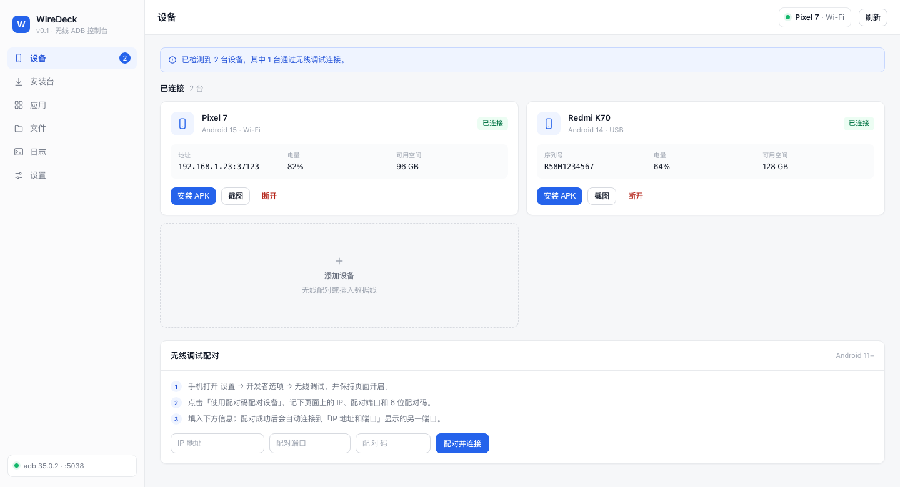

# WireDeck

**在电脑上无线管理安卓手机。**

扫码配对即连，应用管理、APK 安装、文件传输、实时日志与 Shell，全部在一个窗口里完成。

[官网](https://wiredeck.woyuxiaji.cn) · [下载](https://github.com/Rouarn/wiredeck/releases/latest) · [使用文档](https://wiredeck.woyuxiaji.cn/docs.html) · [更新日志](https://wiredeck.woyuxiaji.cn/changelog.html)



## 为什么做这个

Android 自带的「无线调试」很好用，但门槛不低：要找 IP、记端口、输入配对码，再敲一堆 `adb` 命令。

WireDeck 把这些步骤封装成图形界面——手机扫一下电脑上的二维码就能连上，之后的安装、卸载、传文件、看日志都不需要命令行，也不用安装 Android Studio。

## 功能

- **无线连接**：扫码配对 / 配对码配对，启动时自动重连上次的设备
- **应用管理**：应用列表与详情、卸载、启动、强制停止、清除数据、导出 APK（文件名优先中文名）
- **APK 安装**：拖放安装、真实传输进度、可取消、失败原因给中文建议
- **文件传输**：一键截图保存到电脑、推送 / 拉取文件、浏览手机目录选择路径
- **实时日志**：按应用过滤 logcat、自动识别崩溃与 ANR、一键复制堆栈
- **Shell 控制台**：常用命令快捷入口、输出与退出码清晰展示、支持复制
- **内置 adb**：无需安装 Android SDK

## 安装

1. 从 [Releases](https://github.com/Rouarn/wiredeck/releases/latest) 下载 DMG；
2. 打开 DMG，把 WireDeck 拖进「应用程序」；
3. 首次打开：右键 WireDeck → 打开。应用未经过 Apple 公证，直接双击会被系统拦截。

如果提示「已损坏」或「无法打开」，在终端执行：

```bash
xattr -dr com.apple.quarantine /Applications/WireDeck.app
```

然后到「系统设置 → 隐私与安全性」点「仍要打开」。

## 连接手机

1. 手机：设置 → 关于手机 → 连续点击「版本号」，开启开发者选项；
2. 设置 → 开发者选项 → 打开「无线调试」；
3. 手机与电脑连接同一个 Wi-Fi；
4. 应用：设备 → 添加设备 → **扫码配对**，手机扫描电脑上的二维码。

也可以选择「使用配对码配对设备」，把手机显示的 IP、配对端口和 6 位配对码填进应用。

## 系统要求

- macOS 11 及以上（Apple Silicon）
- Android 11 及以上

## 开发

前置：Go 1.27+、Node 20+、Xcode Command Line Tools。

```bash
go install github.com/wailsapp/wails/v2/cmd/wails@latest
export PATH="$PATH:$(go env GOPATH)/bin"

cd frontend && pnpm install && cd ..

./scripts/build.sh           # 构建 + 中文本地化 + 内置 adb + ad-hoc 签名
./scripts/package.sh 0.1.0   # 生成 build/WireDeck-0.1.0.dmg
go test ./...                # 单元测试
```

> 直接跑 `wails build` 会缺少本地化资源与内置 adb，请使用 `scripts/build.sh`。

项目结构：

```text
.
├── app.go                # Wails 绑定（前端调用入口）
├── main.go               # 应用启动与窗口配置
├── internal/
│   ├── adb/              # adb 执行器、server、设备与服务解析
│   ├── services/         # 设备、安装、应用、文件、日志、扫码配对
│   ├── model/            # 数据模型
│   └── platform/         # 单实例锁、本机身份
├── frontend/             # Vue 3 + TypeScript + Naive UI
├── website/              # 官网静态站
├── scripts/              # 构建与打包脚本
└── docs/                 # 开发文档、安装说明、截图
```

更多设计细节见 [开发文档](docs/开发文档.md)。

## 技术栈

Wails v2（系统 WebView）+ Go 后端 + Vue 3 + TypeScript + Vite + Pinia + Naive UI + UnoCSS。
设备操作通过内置的 `platform-tools`（adb）执行，发布包自带，无需额外安装。

## 状态

v0.2.0 已发布（Alpha），当前仅支持 macOS（Apple Silicon）。Windows 计划在后续版本。

## 许可证

[MIT](LICENSE)
